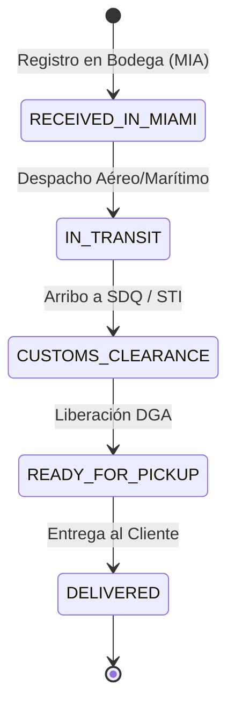
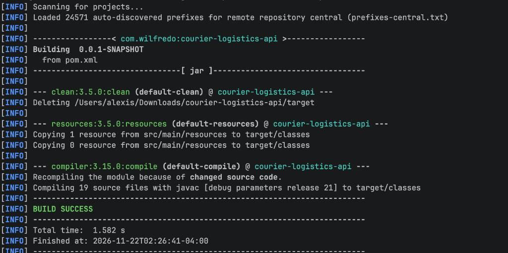
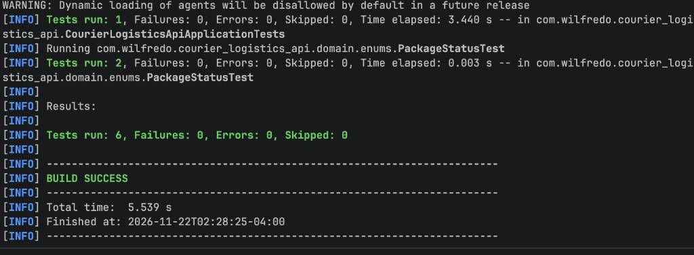

<div align="center">

# Courier & Logistics API

**Motor de Cotización Aduanal (DGA) y Trazabilidad Logística Internacional**  
*Ruta Operativa: Miami (MIA) -> República Dominicana (SDQ / STI)*

[](https://github.com/WilfredoAM22/courier-logistics-api/actions/workflows/ci.yml)


</div>

---

## Descripción del Proyecto

**Courier & Logistics API** es un servicio backend empresarial diseñado para resolver dos procesos críticos en empresas de transporte internacional de carga (*couriers*) hacia República Dominicana:

1. **Cálculo Tributario Automatizado (`TariffEngineService`):** Evalúa mercancías bajo la normativa aduanal dominicana (DGA), diferenciando envíos exentos (de minimis <= \$200.00 USD FOB) de aquellos sujetos a impuestos compuestos en cascada.
2. **Trazabilidad y Máquina de Estados (`TrackingService`):** Gestiona el ciclo de vida completo de cada paquete mediante una máquina de estados estricta (`PackageStatus`) que impide saltos ilógicos en la cadena logística y registra una bitácora auditable de eventos (`TrackingEvent`).

---

## Reglas de Negocio y Arquitectura

### 1. Motor Tarifario DGA (Cálculo en Cascada)
El servicio evalúa el valor **FOB** (*Free On Board*) y la categoría del producto (`ProductCategory`):
* **Envíos Exentos (<= \$200.00 USD):** Exonerados de impuestos aduanales según el Decreto 402-05.
* **Envíos Gravados (> \$200.00 USD):** Se aplica el cálculo escalonado sobre la base imponible:
  \[\text{Arancel (Gravamen)} \rightarrow \text{ISC (Selectivo al Consumo)} \rightarrow \text{ITBIS (18\%)}\]

### 2. Ciclo de Vida del Paquete (State Machine)
Cada actualización en `ShipmentController` es validada por el dominio. Si se intenta realizar una transición no permitida (ej. pasar de *Recibido en Miami* directamente a *Entregado* sin pasar por *Aduanas*), el sistema lanza `InvalidStatusTransitionException`.



---

## Estructura del Código

El proyecto sigue una arquitectura en capas limpia, desacoplando las entidades de persistencia de los contratos expuestos mediante DTOs inmutables:

```text
src/
├── main/java/com/wilfredo/courier_logistics_api/
│   ├── config/          # Configuración transversal (CorsConfig)
│   ├── controller/      # Endpoints REST (QuoteController, ShipmentController)
│   ├── domain/
│   │   ├── enums/       # Reglas de estado y categorías (PackageStatus, ProductCategory)
│   │   └── model/       # Entidades JPA (Shipment, TrackingEvent)
│   ├── dto/             # Contratos de entrada/salida (QuoteRequest, ShipmentTrackingResponse, etc.)
│   ├── exception/       # Manejo centralizado de errores (GlobalExceptionHandler)
│   ├── repository/      # Capa de acceso a datos (ShipmentRepository)
│   └── service/         # Lógica de negocio pura (TariffEngineService, TrackingService)
└── test/java/com/wilfredo/courier_logistics_api/
    ├── domain/enums/    # Pruebas de validación de transiciones (PackageStatusTest)
    └── service/         # Pruebas unitarias del motor de impuestos (TariffEngineServiceTest)
```

---

## Guía de Inicio Rápido

### Prerrequisitos
* **JDK 21** instalado y configurado en el `PATH`.
* No requiere instalación previa de Maven (incluye wrapper `./mvnw`).

### Instalación y Ejecución
1. **Clonar el repositorio:**
   ```bash
   git clone https://github.com
   cd courier-logistics-api
   ```

2. **Ejecutar la suite de pruebas unitarias (JUnit 5):**
   ```bash
   ./mvnw clean test
   ```

3. **Iniciar la aplicación:**
   ```bash
   export DB_PASSWORD=tu_contraseña_local
   ./mvnw spring-boot:run
   ```
   > **En Windows (PowerShell):** `$env:DB_PASSWORD="tu_contraseña_local"; .\mvnw.cmd spring-boot:run`

La API quedará escuchando en `http://localhost:8080`.

---

## Documentación de Endpoints

### 1. Cotizador Aduanal
Calcula el desglose de impuestos estimados para una importación.

* **Endpoint:** `POST /api/v1/quotes`
* **Cuerpo de Petición (`QuoteRequest`):**
  ```json
  {
    "fobValue": 350.00,
    "weightLbs": 5.2,
    "category": "ELECTRONICS"
  }
  ```

### 2. Gestión y Rastreo de Envíos
* **`POST /api/v1/shipments`** — Registra un nuevo paquete en Miami (`CreateShipmentRequest`) y genera su historial inicial.
* **`GET /api/v1/shipments/{trackingNumber}`** — Retorna el estado actual y la línea de tiempo completa (`ShipmentTrackingResponse` + lista de `TrackingEventResponse`).
* **`PATCH /api/v1/shipments/{trackingNumber}/status`** — Avanza el estado del paquete (`UpdateStatusRequest`).

### Manejo Global de Errores (`GlobalExceptionHandler`)

| Código HTTP | Excepción Interna | Escenario |
| :--- | :--- | :--- |
| `400 Bad Request` | `MethodArgumentNotValidException` | Datos de entrada inválidos o campos requeridos faltantes. |
| `404 Not Found` | `ShipmentNotFoundException` | El número de tracking consultado no existe en el sistema. |
| `409 Conflict` / `422` | `InvalidStatusTransitionException` | Intento de cambiar a un estado logístico no permitido por el flujo. |

> **Nota para pruebas rápidas:** En el directorio `/request` del repositorio encontrarás archivos `.http` listos para ejecutarse directamente desde IntelliJ IDEA o VS Code (REST Client).

---

## Evidencias de Integración y Pruebas

<details>
<summary><b>Ver capturas de Compilación y Ejecución de Pruebas (JUnit 5)</b></summary>
<br>

**Compilación Exitosa (`./mvnw clean compile`)**


**Ejecución de Pruebas Unitarias (`./mvnw test`)**


</details>

